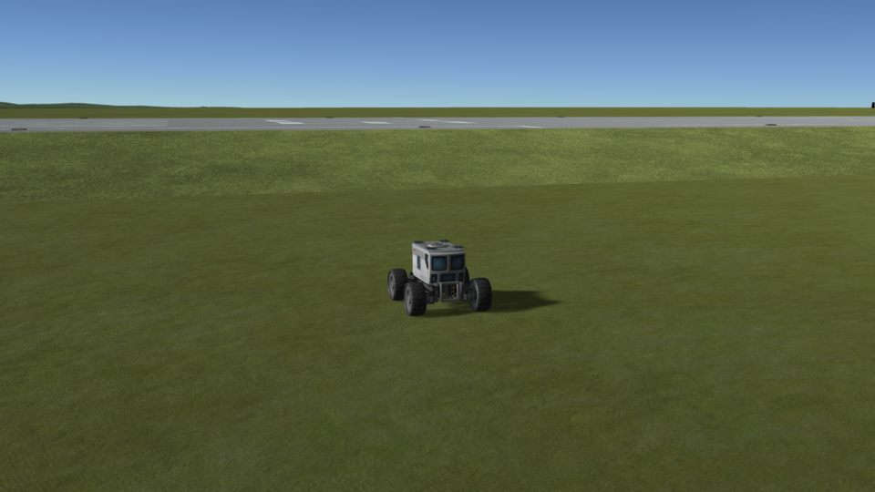
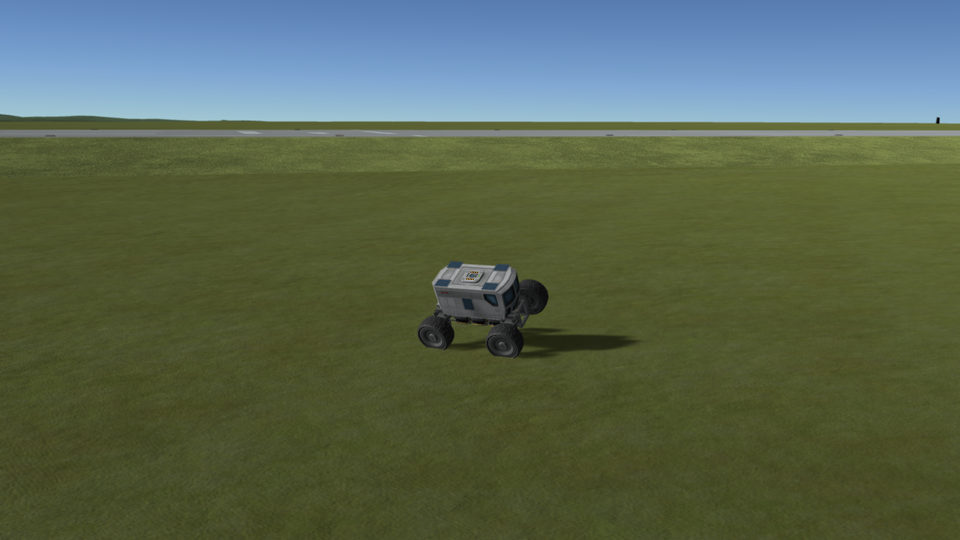
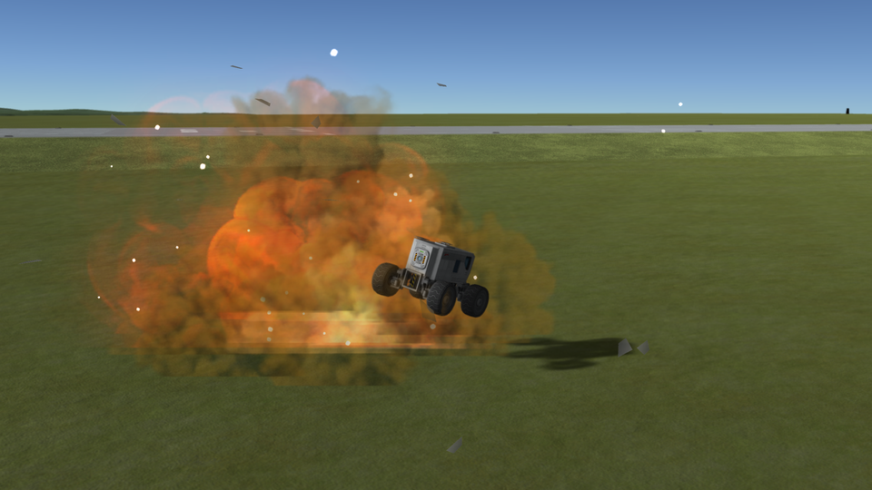

# Auto Strut Fix

**⚠️ Work in progress.** This is an active investigation, not a finished mod. The figures, the code and the conclusions on this page can still change, and several questions are still open — they are listed in [Work in progress](#work-in-progress).

A fix for stock KSP 1.12, kept as small as possible: one Harmony patch, in one short source file. It is a
mod of its own, built and measured on top of
[KSP Community Fixes](https://github.com/KSPModdingLibs/KSPCommunityFixes), the base most players run.
Here is what it fixes:

> **When KSP rebuilds the autostruts of a vessel while the vessel is bent, the new autostruts hold it
> bent.** A part breaking off in the middle of a rollover is enough: the rover lands back on its wheels
> and, brakes on and hands off the controls, keeps turning on the spot until the save is reloaded.

**How this was made.** The investigation and the code were written with Claude, Anthropic's AI
assistant. Everything here was reviewed and validated by a human — me — who very much enjoyed
learning along the way how KSP holds the parts of a craft together. I am saying so up front, because
contributions made with an AI deserve a closer look than others, and because some people would rather
stop reading here. That look is what this page is built for: every figure on it is read on the game's
screen or in this mod's log, the protocol that produces them is played by a public script on a stock
install, the stock code quoted here is a handful of lines anyone can check, and the fix is one short file
you can read in one sitting.

## Why bent autostruts matter

An autostrut is a joint KSP adds between a part and another part further away on the same vessel, to
stiffen it: wheels and landing legs have one by default. KSP throws these joints away and builds them again
every time the vessel changes — a part breaking off, a stage decoupling, a docking, the vessel going off
rails — and it builds them on the shape the vessel has at that instant.

Most of the time that shape is the vessel's own, and nothing shows. In the middle of a crash, it is not:
the vessel bends under the shocks, and a part breaking off has every autostrut built again on that bent
shape. Once the vessel comes to rest, its new autostruts pull its parts towards the bent shape, the joints
made when it was loaded pull them back towards the original one, and neither ever gives way.

On a rover, that is plain to see. It rolls over, loses a solar panel or two, lands back on its wheels and
then turns on the spot, brakes on and nothing touched, slowly or fast, for as long as you watch: some of
its wheels turn one way, some the other, one does not turn at all. Reloading the save stops it: every joint
is then built again, on the same shape.

  


*KSP 1.12.5 without this mod, with [KSP Community Fixes](https://github.com/KSPModdingLibs/KSPCommunityFixes).
The [rollover protocol](docs/checking-the-culprit-rollover.md#the-protocol): the rover drives away at full
throttle, steers hard at 15 m/s, rolls over and loses parts on the way. Then, once it has landed on its
wheels, brakes on and no control touched: one frame every 9.4 seconds, the camera fixed, over one full
turn.*

## The culprit: an autostrut holds the pose it was built in

**What goes wrong.** KSP rebuilds a vessel's autostruts on the physics step after any change to it.
`Part.SecureAutoStrut` builds each one as a Unity `ConfigurableJoint` between the two parts as they are at
that instant, and such a joint brings its parts back to the pose they had when it was set up. Nothing on
that path looks at the vessel's original layout. A wheel can then be held by two joints that disagree: its
attach joint, made at load on the original layout, and a new autostrut, made on the bent one. The wheels of
KSP read the speed of their rigidbody to work out how they slide on the ground; a wheel that the physics
engine keeps correcting without it going anywhere looks like a wheel that slides, its tyre pushes, and the
rover turns.

**KSP Community Fixes and its `AutoStrutDrift`.** KSP Community Fixes already has a patch for autostruts
rebuilt after a change to the vessel. It moves the joint's anchors to the original layout and turns the
joint's target by the difference, and its computation is the right one. What stops it is a slip in the
stock joints: `PartJoint.SetJointLimits` gives the twist +180° as its lower limit, where Unity expects
−180°, which holds the twist where the joint was set up. With `AutoStrutDrift` on, the rover still turns.
Fixing that limit is what would make `AutoStrutDrift` work as written, but every joint it is fixed for
would then twist as easily as it bends, where every craft so far was built with joints whose twist does not
give. Which way belongs in KSP Community Fixes is for its maintainers to judge; the full chapter sets out
the three ways out.

**→ Full chapter: [The culprit](docs/the-culprit.md)**

## The fix: autostruts set up on the original layout

The mod has three modes, one or the other, set by `mode` in [Settings](#settings). Nothing is saved in any
of them; removing the mod gives the stock behaviour back at the next load.

**→ Full chapter: [The fix](docs/the-fix.md)**

### `OriginalPose`, the default

**How it works.** This mode turns `AutoStrutDrift` of KSP Community Fixes off, and does its job in its
place. For each autostrut KSP builds in flight, this mod puts the part, for that instant only, where the
vessel's original layout places it relative to the strut's anchor, sets the joint up again so that it
takes that pose as its own, and puts the part back where it was. The joint then brings the part back to
the vessel's own shape, in agreement with the part's other joints.

**Why `AutoStrutDrift` is off.** It does the same job on the same autostruts, and this mod rewrites
everything it sets up, so the mod takes it off when the main menu shows, before any flight. Both say so in
`KSP.log`.

**Why the default.** The stock joint stays exactly as it is, limits and springs included: giving its twist
a proper lower limit would let a target act, but would also let every joint twist as easily as it bends.

**→ Details: [How OriginalPose works](docs/the-fix.md#how-originalpose-works)**

### `TwistLimitKSPCF`

The other way: the mod gives the twist of the autostruts `AutoStrutDrift` handles a proper range, and leaves
`AutoStrutDrift` on, which then brings the parts back by itself. Those autostruts then twist as easily as
they bend. This mode is there to show that `AutoStrutDrift` works once the limit lets it, and for the
maintainers of KSP Community Fixes to try it in game.

**→ Details: [How TwistLimitKSPCF works](docs/the-fix.md#how-twistlimitkspcf-works)**

### `TwistLimit`

The same, for every part joint KSP sets up: attach joints, and every autostrut, those `AutoStrutDrift`
leaves alone included. `AutoStrutDrift` stays on. This changes the game the most: every joint of every
vessel then twists as easily as it bends.

**→ Details: [How TwistLimit works](docs/the-fix.md#how-twistlimit-works)**

## Checked: a rollover

A rover with its wheels autostrutted to its cabin is rolled over until it lands back on its wheels with
two parts broken off, three times, then watched for thirty seconds, brakes on and nothing touched, on the
heading shown by the navball. On stock, `AutoStrutDrift` of KSP Community Fixes included, all three turned
on the spot, by 9° to 126°; with this mod, in any of its three modes, none moved. The mod's log shows the
wheels a few degrees away from the original layout when their autostruts were rebuilt during the rollover.

**→ Full chapter: [Checking the culprit: a rollover](docs/checking-the-culprit-rollover.md)**

## Work in progress

KSP rebuilds autostruts in many more situations than a crash. Each one below is a place where this mod
changes what stock does, and so where it could break something. What you would see, and how to check it
by hand:

- **Loading a save, launching a craft.** Autostruts are built when a vessel goes off rails, while it
  settles onto its wheels or legs. A rover that turns on its own, or a craft that twists, right after a
  load or a launch, and stops after the next load, would be the same trouble. Load a wheeled craft on
  uneven ground a few times, without this mod and with it, and watch its heading with the brakes on.
- **Large stations.** A big station that starts to sway after a load, until it breaks apart, and is fine
  after the next load, may come from the same joints. Load an autostrutted station a few times, without
  this mod and with it, with SAS off and on.
- **Docking and undocking.** Both rebuild the autostruts of both vessels. Dock and undock two
  autostrutted vessels, and look for one that keeps turning or flexing once they are apart or together.
- **Decoupling.** A stage that separates rebuilds the autostruts of both halves. Decouple a stage from a
  bent rocket, under thrust, and look for a craft that keeps flexing afterwards.
- **EVA construction.** Adding or removing a part rebuilds the vessel's autostruts. Add and remove parts
  on an autostrutted base, and look for parts that move after the change.
- **Robotic parts.** An autostrut that goes through a robotic part is left as stock builds it, as
  KSP Community Fixes does: such a craft behaves as on stock.

## Install

Copy the `GameData\KSPFixAutoStrut` folder into the `GameData` folder of KSP. It needs
[Harmony](https://github.com/KSPModdingLibs/HarmonyKSP), as KSP Community Fixes does.

## Settings

`GameData\KSPFixAutoStrut\PluginData\settings.cfg` is read once, when KSP starts:

```
// OriginalPose (the default), TwistLimitKSPCF or TwistLimit.
mode = OriginalPose

// How much the mod writes to KSP.log: Error, Warning, Info or Debug.
logLevel = Info
```

- `mode`, one of three: `OriginalPose` sets rebuilt autostruts up on the vessel's original shape and turns
  `AutoStrutDrift` of KSP Community Fixes off; `TwistLimitKSPCF` gives the twist of the autostruts
  `AutoStrutDrift` handles a proper range and leaves it on; `TwistLimit` does the same for every part joint.
  The last two change how stiff joints are (see [The fix](docs/the-fix.md#three-modes)).
- At `Debug`, the mod writes one line to `KSP.log` for every autostrut built in flight, with how far its
  part was from the vessel's original layout at that instant.

## Build

Set `KSPDIR` to the folder of a KSP install with Harmony in its `GameData`, then run `build.bat`: it
compiles `GameData\KSPFixAutoStrut\KSPFixAutoStrut.dll`. Installing is up to you.

## License

[MIT](LICENSE).
