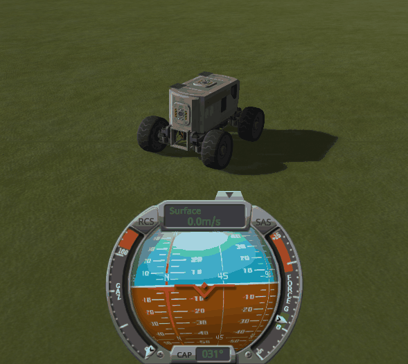
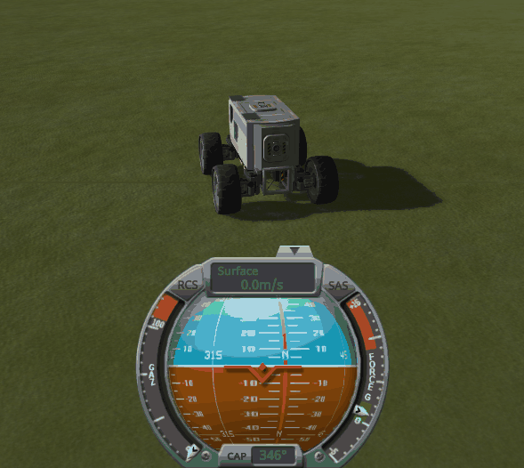

# Checking the culprit: a rollover

Part of [Auto Strut Fix](../README.md). A rover rolls over, breaks parts off on the way, and lands back on
its wheels. Does it then stay still, brakes on and hands off the controls, or turn on the spot? Played
without this mod, then with it in each of its three modes.

## The install

KSP 1.12.5 with [KSP Community Fixes](https://github.com/KSPModdingLibs/KSPCommunityFixes) 1.41.1 (and the
Harmony and ModuleManager it needs), the base most players run. *On stock* below means this install, with
KSP Community Fixes as it ships: its `AutoStrutDrift` patch on. *With this mod* means this install with
Auto Strut Fix 0.1.0, its log level set to `Debug` in `PluginData/settings.cfg`, in one of its three modes
(see [The fix](the-fix.md#three-modes)): `OriginalPose`, the default, which turns `AutoStrutDrift` off,
`TwistLimitKSPCF` and `TwistLimit`, which leave it on. [KSP-MCPServer](https://github.com/lhervier/KSP-MCPServer) is installed
too, to play the protocol by script.

## The protocol

The save is [rollover-kerbin.sfs](../diag/checking-the-culprit-rollover/rollover-kerbin.sfs): a sandbox
game with a small rover, four medium wheels under a lander cabin, with batteries and solar panels on its
sides, parked in the grass west of the KSC, facing south. Jebediah Kerman is at the wheel and volunteered
for every try; Bill Kerman, beside him, did not. Its wheels have their autostrut set to the
heaviest part, as wheels have by default. Copy the save into the folder of a sandbox game, and load it.

1. Release the brakes and drive straight ahead at full throttle, up to 15 m/s.
2. Steer left, at 40 % of the wheel steering, for two seconds: the rover rolls over.
3. Let go of every control and put the brakes on.
4. Wait ten seconds. A try counts if the rover ends on its wheels and lost parts on the way; otherwise,
   load the save again and start over.
5. Note the heading on the navball, wait thirty seconds, and note it again.

Played by [run-rollover.py](../diag/automation/run-rollover.py), three tries that count in each install:
it takes a screenshot at each reading. Started from the main menu with the save copied into a sandbox game
`<game>`: `python run-rollover.py --folder <game> --runs 3 --out out`. The heading readings below are the
ones the navball shows on the screenshots; the mission clock in their top left corner shows the time
between them. What the script printed, for each series: [on stock](../diag/checking-the-culprit-rollover/stock/runs.json),
[with this mod](../diag/checking-the-culprit-rollover/fix/runs.json),
[in `TwistLimitKSPCF` mode](../diag/checking-the-culprit-rollover/twist-limit-kspcf/runs.json),
[in `TwistLimit` mode](../diag/checking-the-culprit-rollover/twist-limit/runs.json); the KSP logs:
[on stock](../diag/checking-the-culprit-rollover/stock/KSP.log),
[with this mod](../diag/checking-the-culprit-rollover/fix/KSP.log),
[in `TwistLimitKSPCF` mode](../diag/checking-the-culprit-rollover/twist-limit-kspcf/KSP.log),
[in `TwistLimit` mode](../diag/checking-the-culprit-rollover/twist-limit/KSP.log).

## On stock

The three tries that count all were the first three: each rover lost two parts and landed on its wheels.
All three turned on the spot, brakes on and nothing touched, at very different rates.

| Try | Heading | 30 s later | Turned |
|---|---|---|---|
| 1 | 164° ([screenshot](../imgs/checking-the-culprit-rollover/stock/run-1-a.png)) | 266° ([screenshot](../imgs/checking-the-culprit-rollover/stock/run-1-b.png)) | +102° |
| 2 | 118° ([screenshot](../imgs/checking-the-culprit-rollover/stock/run-2-a.png)) | 244° ([screenshot](../imgs/checking-the-culprit-rollover/stock/run-2-b.png)) | +126° |
| 3 | 023° ([screenshot](../imgs/checking-the-culprit-rollover/stock/run-3-a.png)) | 014° ([screenshot](../imgs/checking-the-culprit-rollover/stock/run-3-b.png)) | −9° |



*On stock, a rover played through the same protocol, outside the three tries above: once it has landed on
its wheels, brakes on and no control touched, one frame every 9.4 seconds, the camera fixed, over one full
turn.*

## With this mod

The same install, one series in each of the three modes, set by `mode` in `PluginData/settings.cfg`:

- `OriginalPose`, the default: the mod sets each new autostrut up on the original layout and turns
  `AutoStrutDrift` off. Try 2 did not end on the rover's wheels and was dropped; tries 1, 3 and 4 count.
- `TwistLimitKSPCF`: the mod fixes the lower twist limit of the autostruts `AutoStrutDrift` handles, and
  leaves it on to bring the parts back by itself. The first three tries count.
- `TwistLimit`: the mod fixes the lower twist limit of every part joint KSP sets up, attach joints and every
  autostrut included, and leaves `AutoStrutDrift` on. Tries 1 and 4 did not end on the rover's wheels and
  were dropped; tries 2, 3 and 5 count.

In every try that counts, the rover lost two parts and landed on its wheels. None of them turned, in any
mode: the one degree of `OriginalPose` try 3 is the navball rounding to the degree.

| Mode | Try | Heading | 30 s later | Turned |
|---|---|---|---|---|
| `OriginalPose` | 1 | 110° ([screenshot](../imgs/checking-the-culprit-rollover/fix/run-1-a.png)) | 110° ([screenshot](../imgs/checking-the-culprit-rollover/fix/run-1-b.png)) | 0° |
| `OriginalPose` | 3 | 075° ([screenshot](../imgs/checking-the-culprit-rollover/fix/run-2-a.png)) | 074° ([screenshot](../imgs/checking-the-culprit-rollover/fix/run-2-b.png)) | −1° |
| `OriginalPose` | 4 | 085° ([screenshot](../imgs/checking-the-culprit-rollover/fix/run-3-a.png)) | 085° ([screenshot](../imgs/checking-the-culprit-rollover/fix/run-3-b.png)) | 0° |
| `TwistLimitKSPCF` | 1 | 050° ([screenshot](../imgs/checking-the-culprit-rollover/twist-limit-kspcf/run-1-a.png)) | 050° ([screenshot](../imgs/checking-the-culprit-rollover/twist-limit-kspcf/run-1-b.png)) | 0° |
| `TwistLimitKSPCF` | 2 | 037° ([screenshot](../imgs/checking-the-culprit-rollover/twist-limit-kspcf/run-2-a.png)) | 037° ([screenshot](../imgs/checking-the-culprit-rollover/twist-limit-kspcf/run-2-b.png)) | 0° |
| `TwistLimitKSPCF` | 3 | 028° ([screenshot](../imgs/checking-the-culprit-rollover/twist-limit-kspcf/run-3-a.png)) | 028° ([screenshot](../imgs/checking-the-culprit-rollover/twist-limit-kspcf/run-3-b.png)) | 0° |
| `TwistLimit` | 2 | 063° ([screenshot](../imgs/checking-the-culprit-rollover/twist-limit/run-1-a.png)) | 063° ([screenshot](../imgs/checking-the-culprit-rollover/twist-limit/run-1-b.png)) | 0° |
| `TwistLimit` | 3 | 092° ([screenshot](../imgs/checking-the-culprit-rollover/twist-limit/run-2-a.png)) | 092° ([screenshot](../imgs/checking-the-culprit-rollover/twist-limit/run-2-b.png)) | 0° |
| `TwistLimit` | 5 | 041° ([screenshot](../imgs/checking-the-culprit-rollover/twist-limit/run-3-a.png)) | 041° ([screenshot](../imgs/checking-the-culprit-rollover/twist-limit/run-3-b.png)) | 0° |



*With this mod, any mode: a rover played through the same protocol, outside the tries of this page, once it
has landed on its wheels with two parts lost, brakes on and no control touched, one frame every 9.4 seconds,
the camera fixed, as on stock. Over the time the rover on stock took for one full turn, the heading stays at
346°. Recorded in `OriginalPose` mode; in the two other modes, the tries above show the same.*

### What the log says, in OriginalPose mode

By the time the main menu shows, KSP Community Fixes has applied `AutoStrutDrift`, and this mod has taken
it off again:

```
[KSPCommunityFixes] Patch AutoStrutDrift applied.
[AutoStrutFix] Mode OriginalPose: AutoStrutDrift of KSP Community Fixes turned off
```

At the `Debug` level, the mod then writes a line for every autostrut KSP builds in flight. Each try writes
eight of them while the save loads, four wheels twice over (KSP first struts each wheel to another wheel,
then, a second later, to the cabin), all with the wheels on the original layout:

```
[AutoStrutFix] [DEBUG] Autostrut from wheelMed to mk2LanderCabin.v2 set on the original layout; the part was 0.000° and 0.0000 m away from it
```

Then, a few seconds later, in the middle of the rollover, four or eight more: the vessel was changed once
or twice within the same second, as parts broke off. Those come with the wheels away from the original
layout, on the shape stock would have kept. Try 1:

```
[AutoStrutFix] [DEBUG] Autostrut from wheelMed to mk2LanderCabin.v2 set on the original layout; the part was 3.722° and 0.1051 m away from it
[AutoStrutFix] [DEBUG] Autostrut from wheelMed to mk2LanderCabin.v2 set on the original layout; the part was 1.168° and 0.0194 m away from it
[AutoStrutFix] [DEBUG] Autostrut from wheelMed to mk2LanderCabin.v2 set on the original layout; the part was 2.789° and 0.0790 m away from it
[AutoStrutFix] [DEBUG] Autostrut from wheelMed to mk2LanderCabin.v2 set on the original layout; the part was 2.425° and 0.0706 m away from it
```

Over the four tries, the lines written during the rollovers put the wheels 1.2° to 4.7° and 1.9 to 13.4 cm
away from the original layout.

### What the log says, in TwistLimitKSPCF mode

KSP Community Fixes applies `AutoStrutDrift`, and this mod leaves it on:

```
[KSPCommunityFixes] Patch AutoStrutDrift applied.
[AutoStrutFix] Mode TwistLimitKSPCF: AutoStrutDrift of KSP Community Fixes left on
```

Then, at the `Debug` level, one line for every autostrut KSP builds in flight: eight while each save loads,
with the wheels on the original layout, then four or eight in the middle of each rollover. Try 2, its first
three:

```
[AutoStrutFix] [DEBUG] Autostrut from wheelMed to mk2LanderCabin.v2 given a twist range of [-177, 177]; the part was 1.945° and 0.0673 m away from the original layout
[AutoStrutFix] [DEBUG] Autostrut from wheelMed to mk2LanderCabin.v2 given a twist range of [-177, 177]; the part was 2.222° and 0.0397 m away from the original layout
[AutoStrutFix] [DEBUG] Autostrut from wheelMed to mk2LanderCabin.v2 given a twist range of [-177, 177]; the part was 2.218° and 0.0128 m away from the original layout
```

Over the three tries, the lines written during the rollovers put the wheels 0.3° to 4.2° and 0.6 to 15.1 cm
away from the original layout.

### What the log says, in TwistLimit mode

The mod fixes the twist limit of every part joint when KSP starts, then leaves `AutoStrutDrift` on:

```
[AutoStrutFix] Twist limit of every part joint fixed
[KSPCommunityFixes] Patch AutoStrutDrift applied.
[AutoStrutFix] Mode TwistLimit: AutoStrutDrift of KSP Community Fixes left on
```

Then, at the `Debug` level, the same lines as in `TwistLimitKSPCF` mode for the autostruts: eight while each
save loads, four or eight in the middle of each rollover. Try 2:

```
[AutoStrutFix] [DEBUG] Autostrut from wheelMed to mk2LanderCabin.v2 given a twist range of [-177, 177]; the part was 1.953° and 0.1327 m away from the original layout
[AutoStrutFix] [DEBUG] Autostrut from wheelMed to mk2LanderCabin.v2 given a twist range of [-177, 177]; the part was 3.960° and 0.0821 m away from the original layout
[AutoStrutFix] [DEBUG] Autostrut from wheelMed to mk2LanderCabin.v2 given a twist range of [-177, 177]; the part was 3.339° and 0.1018 m away from the original layout
[AutoStrutFix] [DEBUG] Autostrut from wheelMed to mk2LanderCabin.v2 given a twist range of [-177, 177]; the part was 3.639° and 0.0444 m away from the original layout
```

Over the five tries, the lines written during the rollovers put the wheels 0.2° to 4.0° and 0.8 to 13.3 cm
away from the original layout.

## What the measurements say

On stock, `AutoStrutDrift` of KSP Community Fixes included, every rover that lost parts in its rollover and
landed on its wheels turned on the spot, brakes on: by 9° to 126° in thirty seconds. With this mod, in any of
its three modes, none did. The autostruts of the wheels were rebuilt in the middle of the rollover, with the
wheels up to a few degrees and a dozen centimetres away from the vessel's original layout. Stock builds the
new joints on that bent shape, and `AutoStrutDrift` cannot turn them back on the twist (see
[The culprit](the-culprit.md)). In `OriginalPose` mode, this mod builds them on the original shape; in the
two twist limit modes, it gives their twist a proper range, for those autostruts or for every joint, and
`AutoStrutDrift` alone then brings the wheels back: its computation works, once the twist limit lets it.
